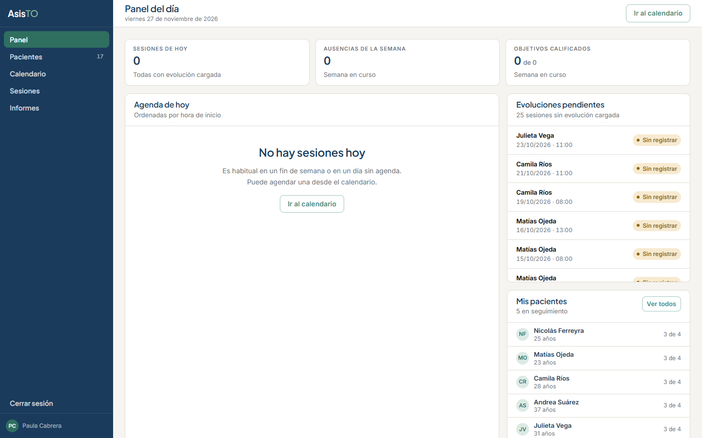
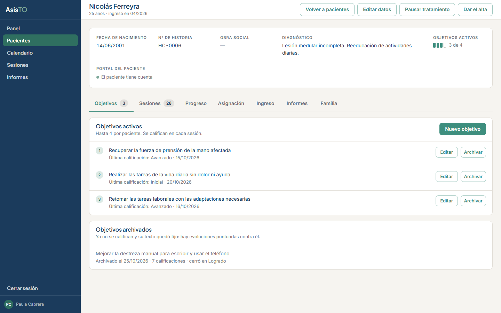
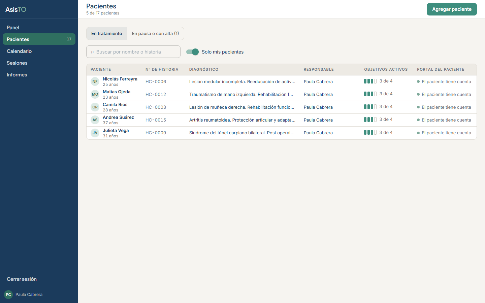
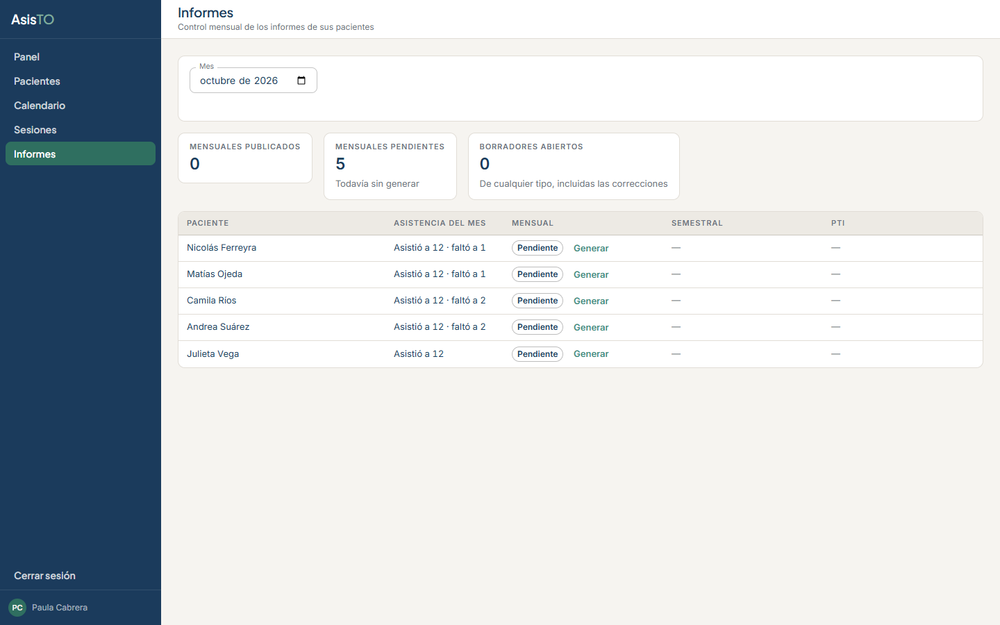

# AsisTO

**Gestión de asistencias y seguimiento terapéutico para terapia ocupacional.**
Reemplaza el cuaderno de papel de la terapeuta: agenda, pacientes, objetivos,
evolución sesión por sesión e informes mensuales, semestrales y PTI generados
con IA. Además tiene un portal para las familias y otro para los pacientes.

Práctica Profesionalizante III · IES 9-023, Mendoza. Lo hice en seis entregas,
a partir de un [relevamiento](docs/relevamiento-to.md) con una terapeuta en
ejercicio.


| Panel del día | Ficha del paciente |
|---|---|
|  |  |
| **Pacientes** | **Control mensual de informes** |
|  |  |

<sub>Capturas con los datos ficticios de `seed_demo.sql`.</sub>

## Lo más interesante

- **Cinco roles con permisos verificados en el servidor:** terapeuta, RRHH,
  admin, familiar y paciente. Cada endpoint valida rol y vínculo:
  el familiar solo ve lo de su paciente y RRHH no ve nada clínico. Un barrido
  prueba todas las rutas con 8 identidades distintas.
- **Las reglas de negocio viven en la base:** triggers, procedimientos y
  restricciones. Por ejemplo, entre 3 y 4 objetivos activos por paciente, o
  una evolución solo sobre una sesión del terapeuta asignado. Ver
  [reglas de negocio](docs/metodologia/reglas-de-negocio.md) y
  [concurrencia](docs/metodologia/concurrencia.md).
- **Informes con IA y revisión humana:** la IA (la API de Anthropic, o un
  modelo local con Ollama, sin salida a internet) redacta un borrador a partir
  de las evoluciones, sin recibir el nombre del paciente. La terapeuta lo
  revisa, lo corrige y lo publica, y el familiar lo descarga en PDF. Sin IA
  configurada, el borrador se arma con una plantilla.
- **Seguridad pensada para datos de salud de menores:** sesión en cookie
  HttpOnly, CSRF, bloqueo por intentos, el mismo tiempo de respuesta exista o
  no el email, revocación de sesiones, CSP y auditoría de accesos. Ver
  [seguridad](docs/seguridad.md).
- **Contrato de la API documentado con respuestas reales** en [`docs/`](docs).
- **Tests en tres capas:** base de datos (reglas, bordes, concurrencia,
  permisos), backend (JWT, RBAC, errores) y frontend.

## Estado

**Completo: Entrega 6 (informes con IA y portal del paciente).** Las seis
versiones están cerradas: módulo clínico, gestión y RRHH, seguridad y agenda,
portal familiar e ingreso, duplas y plantillas, e informes con IA con el portal
del paciente. El detalle está en [Qué funciona hoy](#qué-funciona-hoy) y en
[Entregas](#entregas).

- **Frontend:** React + Vite + Material UI (pnpm)
- **Backend:** Python + Flask + SQLAlchemy
- **Base de datos:** MySQL 8.0+

---

## Qué funciona hoy

Un terapeuta entra, ve su día, registra pacientes y objetivos, agenda
sesiones y carga la evolución de cada objetivo. Todo eso anda contra base
real, no está mockeado.

| | Estado |
|---|---|
| Login con JWT y control de acceso por rol | ✅ |
| Panel del día (agenda, pendientes, accesos rápidos) | ✅ |
| Pacientes: alta y listado con búsqueda | ✅ |
| Ficha del paciente: objetivos, historial, progreso | ✅ |
| Objetivos: crear, editar, archivar, reactivar | ✅ |
| Calendario semanal y alta de sesiones | ✅ |
| Carga de evolución sobre objetivos | ✅ |
| Las reglas de negocio, aplicadas **en la base** | ✅ |
| Editar paciente, pausar tratamiento, dar el alta y reactivar | ✅ (Entrega 2–3) |
| Asignación paciente–terapeuta; escribir solo sobre pacientes asignados | ✅ (Entrega 3) |
| Recuperación de contraseña, bloqueo por intentos, auditoría de accesos | ✅ (Entrega 3) |
| Registro del día con notas en renglones; agenda semanal recurrente | ✅ (Entrega 3) |
| Mínimo de 3 y máximo de 4 objetivos activos por paciente | ✅ (Entrega 3) |
| Informes mensual, semestral y PTI: generar (con o sin IA), revisar, publicar, corregir, historial y PDF | ✅ (Entrega 6) |
| Control mensual de informes hechos y pendientes (`/informes`) | ✅ (Entrega 6) |
| El familiar lee y descarga los informes publicados de su paciente | ✅ (Entrega 6) |
| Portal del paciente: sus objetivos y su progreso, solo lectura | ✅ (Entrega 6) |
| Sesión en cookie segura, cierre de sesión que revoca, límites contra fuerza bruta (ver `docs/seguridad.md`) | ✅ (auditoría V6) |

> **Después de hacer `git pull` de esta versión (23/10/2026)** hay que, una vez:
> 1. `backend\venv\Scripts\pip install -r backend\requirements.txt` (se actualizaron Flask, PyJWT y otras por seguridad),
> 2. `cd frontend` y `pnpm install` (Vite 6),
> 3. recargar la base: `schema.sql` cambió (columna nueva en `usuarios`, mensajes y auditoría). Ver el paso 2 y correr después `generar_hashes.py --aplicar --todos`.
>
> El navegador ya no guarda el token: si alguien tenía la sesión abierta, vuelve a pedir el login una vez.

**Informes con IA — cómo se configura.** Sin configuración, los informes se
arman con la plantilla del centro y todo funciona. Para redactarlos con IA se
agregan al `.env` `INFORMES_IA_PROVEEDOR=anthropic` e `INFORMES_IA_API_KEY`
(ver `backend/.env.example`). A la IA nunca se le envía el nombre del paciente,
y el resultado siempre queda como borrador para que la terapeuta lo revise.
Antes de activarla en el centro, conviene que la coordinación confirme que
los datos del período pueden enviarse a un proveedor externo.

---

## Requisitos previos

Instalar una sola vez, en Windows 10/11:

| Herramienta | Versión mínima | Verificar con |
|---|---|---|
| Python | 3.11 | `python --version` |
| Node.js | 18 | `node --version` |
| pnpm | 9 | `pnpm --version` |
| MySQL Server | 8.0 | `mysql --version` |
| Git | 2.40 | `git --version` |

Si `pnpm` no está instalado: `npm install -g pnpm`

Si `mysql` no se reconoce como comando, agregar a la variable de entorno
`Path` la carpeta `C:\Program Files\MySQL\MySQL Server 8.0\bin` y abrir una
terminal nueva.

---

## 1. Configurar el acceso a MySQL (una sola vez)

Para no escribir la contraseña en cada comando ni dejarla en el historial
de la terminal, se usa un **login-path** de MySQL. Queda guardado cifrado
en `%APPDATA%\MySQL\.mylogin.cnf`, fuera del repositorio.

Cada integrante lo crea una vez en su máquina:

```powershell
mysql_config_editor set --login-path=asisto --host=localhost --user=root --password
```

Pide la contraseña de MySQL y no la vuelve a pedir. Verificar que quedó
bien:

```powershell
mysql --login-path=asisto -e "SELECT VERSION();"
```

Si tira `mysql_config_editor no se reconoce`, falta agregar al `Path` la
carpeta `C:\Program Files\MySQL\MySQL Server 8.0\bin`. Para la sesión
actual alcanza con:

```powershell
$env:Path += ";C:\Program Files\MySQL\MySQL Server 8.0\bin"
```

> El login-path es por máquina y no se versiona. Los cuatro integrantes
> tienen que crearlo con el mismo nombre (`asisto`) para que los comandos
> del proyecto sean idénticos para todos.

---

## 2. Crear la base de datos

`schema.sql` crea la base entero: **arranca con `DROP DATABASE IF EXISTS
asisto`**, así que se puede correr las veces que haga falta, pero borra
todo lo que haya cargado.

```powershell
cd C:\dev\asisTO
mysql --login-path=asisto -e "source backend/database/schema.sql"
mysql --login-path=asisto asisto -e "source backend/database/seed.sql"
```

El primero deja **21 tablas, 2 vistas, 8 triggers y 23 procedimientos
almacenados**. El segundo carga datos de prueba con id fijos, para que las
cuatro instancias locales arranquen idénticas.

> **Por qué hay tanta lógica en la base y no en Python.** Las reglas de
> negocio viven en triggers y procedimientos porque la base es el único
> punto por el que pasa *todo*: la API, un script de migración, alguien
> con un cliente de MySQL abierto. Una regla que solo vive en el backend
> se saltea con un `INSERT` directo. El backend **traduce** el veredicto
> de la base al usuario, no lo reimplementa — si lo duplicara, en algún
> momento las dos versiones dirían cosas distintas.

Verificar:

```powershell
mysql --login-path=asisto asisto -e "SELECT * FROM v_resumen_sesiones;"
```

> Las contraseñas del seed son **placeholders**, no hashes bcrypt válidos:
> ningún login va a funcionar con esos datos. Ver el paso 4.

### Dos seeds, se corre uno u otro

| Archivo | Contenido | Para qué |
|---|---|---|
| `seed.sql` | 4 pacientes (1 dado de baja), 13 sesiones | **El que usan los tests.** Chico, estable, con id conocidos. |
| `seed_demo.sql` | 16 pacientes, ~630 sesiones en 7 semanas | Ver la interfaz con volumen real y hacer pruebas con personas. |

Para cargar los datos de demostración:

```powershell
mysql --login-path=asisto -e "source backend/database/schema.sql"
mysql --login-path=asisto asisto -e "source backend/database/seed_demo.sql"
```

Trae 3 terapeutas, agenda de lunes a viernes con días de hasta 8 sesiones,
mezcla de los tres estados, sesiones con evolución y sin, objetivos
archivados con historia, pacientes con y sin cuenta, un paciente dado de
baja y una cuenta deshabilitada.

**Ningún test depende de este archivo:** los runners construyen sus propias
bases con `schema.sql` + `seed.sql`. Volver al seed chico es correr
`seed.sql` de nuevo.

---

## 3. Backend

Desde la raíz del repositorio:

```powershell
cd backend
python -m venv venv
.\venv\Scripts\Activate.ps1
pip install -r requirements.txt
```

Si PowerShell bloquea la activación del entorno virtual:

```powershell
Set-ExecutionPolicy -Scope CurrentUser -ExecutionPolicy RemoteSigned
```

Copiar el archivo de ejemplo:

```powershell
copy .env.example .env
```

**Generar los dos secretos.** `SECRET_KEY` y `JWT_SECRET_KEY` son
obligatorios y **no tienen valor por defecto**: si falta cualquiera de los
dos, la aplicación no arranca y explica qué falta. Un default commiteado
sería un secreto público firmando los JWT de todos.

Generar un valor **distinto** para cada uno:

```powershell
python -c "import secrets; print(secrets.token_urlsafe(48))"
```

Después completar el `.env` con esos dos valores, más `DB_USER` y
`DB_PASSWORD`:

```powershell
notepad .env
```

El `.env` está en `.gitignore` y no se commitea nunca.

Levantar la API:

```powershell
python run.py
```

Queda en `http://127.0.0.1:5000`. Para comprobar que responde, en **otra**
terminal:

```powershell
curl http://127.0.0.1:5000/api/health
```

Si `database.conectada` es `false`, revisar `DB_USER` y `DB_PASSWORD`.

---

## 4. Generar las contraseñas de prueba

**Obligatorio para poder loguear.** Los `contrasena_hash` de `seed.sql` son
placeholders, no hashes bcrypt válidos: recién cargado el seed, ningún
login funciona.

No están escritos a mano en `seed.sql` a propósito — bcrypt genera un salt
distinto en cada corrida, así que hardcodearlos dejaría una contraseña fija
commiteada en el repositorio.

Desde `backend/`, con el venv activo:

```powershell
python scripts/generar_hashes.py --aplicar
```

Sin `--aplicar` solo imprime los `UPDATE` sin tocar la base.

Si cargaste **`seed_demo.sql`**, que trae otros usuarios, hay que agregar
`--todos` para que tome los emails de la base en vez de la lista fija:

```powershell
python scripts/generar_hashes.py --aplicar --todos
```

**Hay que volver a correrlo cada vez que se recargue cualquiera de los dos
seeds.**

### Usuarios de prueba

Todos con la contraseña **`asisto2026`**. Son de desarrollo: no usar en
ningún entorno real.

Con **`seed.sql`** (el chico, el de los tests):

| Email | Rol |
|---|---|
| `laura.fernandez@asisto.local` | terapeuta |
| `diego.moyano@asisto.local` | terapeuta |
| `silvia.quiroga@asisto.local` | rrhh |
| `admin@asisto.local` | admin (asigna terapeutas a pacientes; sin acceso clínico) |
| `marta.ledesma@asisto.local` | familiar |
| `jorge.bustos@asisto.local` | familiar |
| `camila.rios@asisto.local` | paciente |

Con **`seed_demo.sql`** se agregan `paula.cabrera` (terapeuta),
`rosa.aguilar` y `hector.nunez` (familiares), y `nicolas.ferreyra`,
`julieta.vega`, `matias.ojeda` (pacientes).

> **Para probar la interfaz, entrá con `paula.cabrera@asisto.local`.** Es
> la terapeuta con el día más cargado del seed de demostración: 6 sesiones
> hoy, 3 sin evolución y 41 pendientes acumuladas. Las tres terapeutas ven
> los mismos 15 pacientes —la cartera es compartida—, así que la diferencia
> está en el panel y el calendario.

**Dos usuarios que "fallan" a propósito y conviene conocer antes de
reportarlos como bug:**

- **`andrea.suarez@asisto.local` da 401.** Tiene `activo = 0`. El mensaje
  es el mismo que el de un email inexistente —`Email o contrasena
  incorrectos`— justamente para no filtrar que la cuenta existe.
- **11 de los 16 pacientes del seed de demostración no tienen login**, y
  eso es correcto: `pacientes.id_usuario` es `NULL`. La identidad clínica
  vive en `pacientes`, no en `usuarios`; un paciente puede existir como
  registro clínico completo sin credenciales (regla 5).

---

## 5. Frontend

Desde la raíz del repositorio, en **otra** terminal (el backend queda
corriendo en la primera):

```powershell
cd frontend
pnpm install
pnpm dev
```

Queda en `http://localhost:5173`. Vite proxea `/api` hacia Flask en el
puerto 5000, así que no hace falta configurar URLs absolutas ni pelear con
CORS en desarrollo.

La pantalla inicial es el login. Después de entrar, cada rol cae en su
pantalla: el terapeuta en `/panel`, y los otros tres en `/rrhh`,
`/familiar` y `/paciente`, que hoy avisan que su módulo llega después.
Entrar a la ruta de otro rol muestra un 403 propio; sin sesión, cualquier
ruta protegida redirige al login.

Rutas del terapeuta: `/panel`, `/pacientes`, `/pacientes/:id` y
`/calendario`.

### Variables de entorno opcionales del frontend

Nadie tiene que configurar esto para desarrollar. Sin ellas, Vite se
comporta exactamente como en los pasos de arriba.

| Variable | Para qué | Sin configurar |
|---|---|---|
| `ASISTO_PUERTO_VITE` | Puerto en el que corre Vite | `5173` |
| `ASISTO_API_URL` | Destino del proxy `/api` | `http://127.0.0.1:5000` |
| `VITE_ENTREGA` | Muestra la app como en una entrega anterior (`1` a `6`) | versión completa |

`VITE_ENTREGA` es solo para hacer una demostración de una entrega vieja sin
tocar ramas: sigue siendo la app de hoy, con la interfaz recortada del lado
del navegador. La API y la base no cambian con esta variable. Se usa así:

```powershell
$env:VITE_ENTREGA=1
pnpm dev
```

---

## 6. Levantar todo (resumen)

Dos terminales, desde la raíz del repositorio:

```powershell
# Terminal 1 — backend
cd C:\dev\asisTO\backend; .\venv\Scripts\python.exe run.py

# Terminal 2 — frontend
cd C:\dev\asisTO\frontend; pnpm dev
```

Abrir **`http://localhost:5173`**.

Cuatro cosas que ahorran media hora de confusión:

- **Levantar primero el backend.** Vite proxea `/api` hacia
  `127.0.0.1:5000`; si Flask no está arriba, el login falla con un error de
  red poco claro en vez de decir qué pasa.
- **Entrar por `localhost`, no por `127.0.0.1`.** `CORS_ORIGINS` tiene
  `http://localhost:5173` y nada más: por `127.0.0.1` el navegador bloquea
  la respuesta y parece que el backend está roto.
- **Si recargaste cualquier seed, volvé a correr `generar_hashes.py`.** Es
  el paso que más se olvida: sin él ningún login funciona y parece que el
  backend está roto.
- **Si el panel del día aparece vacío con `seed_demo.sql`, recargá el
  seed.** Sus fechas se calculan relativas al momento en que se carga
  (`CURDATE()`): si la base se sembró hace días, "hoy" ya no tiene sesiones.
  Recargar es repetir el paso 2 con `seed_demo.sql` y volver a correr
  `generar_hashes.py --aplicar --todos`. `seed.sql` no tiene este problema:
  sus fechas son fijas.

---

## 7. Correr los tests

Tres suites. Las escribe y las mantiene la terminal de auditoría, aparte de
quien escribe el código: los tests no los escribe el mismo que los tiene
que pasar.

```powershell
cd C:\dev\asisTO

# Base de datos: reglas de negocio, casos borde, concurrencia, permisos
powershell -File tests\db\run_all.ps1

# Backend: JWT, RBAC, manejo de errores, revalidación de sesión
powershell -File tests\backend\run_backend_tests.ps1

# Frontend: que no haya código sin camino de usuario
powershell -File tests\frontend\test_codigo_sin_camino.ps1
```

Al cortar `entrega-1`: **50 + 38 + 55 = 143 PASS, 0 FAIL**, más 5 INFO que
son notas, no fallas.

Los de base **crean y borran su propia base temporal**, así que no pisan la
que estés usando para probar a mano. Los de backend hacen lo mismo con
`asisto_test_backend`.

> Si venís de correr la suite de base y la interfaz quedó rara, recargá el
> seed de demostración: algunos tests de concurrencia dejan datos propios.

---

## Estructura

```
asisTO/
├── backend/
│   ├── app/
│   │   ├── __init__.py      factory, CORS, blueprints, manejo de errores
│   │   ├── models/          modelos SQLAlchemy (mapean schema.sql)
│   │   ├── routes/          un blueprint por módulo
│   │   ├── services/        lógica de negocio y reglas críticas
│   │   └── utils/           security.py (JWT/RBAC), errors.py, db.py
│   ├── scripts/
│   │   └── generar_hashes.py  hashes bcrypt para el seed
│   ├── database/
│   │   ├── schema.sql       tablas, triggers, procedimientos, vistas
│   │   ├── seed.sql         datos de prueba (chico, el de los tests)
│   │   └── seed_demo.sql    datos de demostración (volumen real)
│   ├── config.py            configuración, lee de .env
│   ├── requirements.txt
│   ├── run.py               entrypoint de desarrollo
│   └── .env.example
├── frontend/
│   ├── src/
│   │   ├── components/      componentes reutilizables
│   │   ├── pages/           pantallas
│   │   ├── hooks/           usePeticion, useFormularioModal, useAuth
│   │   ├── services/        cliente HTTP
│   │   ├── theme/theme.js   fuente de verdad de la identidad visual
│   │   ├── App.jsx
│   │   └── main.jsx
│   ├── index.html
│   ├── package.json
│   └── vite.config.js
├── docs/                    contrato de la API, con respuestas reales
├── tests/
│   ├── db/                  reglas, bordes, concurrencia, permisos
│   ├── backend/             JWT, RBAC, errores
│   └── frontend/            código sin camino de usuario
└── README.md
```

Los ejemplos de `docs/` son **respuestas reales copiadas de la API**, no
JSON escrito a mano: si el contrato y el código se separan, se nota.

---

## Convenciones

Las convenciones de código, las reglas de negocio, el modelo de roles y el
formato de commits están documentados aparte y son de cumplimiento
obligatorio. Puntos que conviene tener presentes desde el día uno:

- Los colores salen **siempre** de `frontend/src/theme/theme.js`. Nunca un
  hex suelto en un componente.
- Variables y funciones en inglés, comentarios en español.
- Tablas y columnas de la base en español, plural, `snake_case`.
- Credenciales solo en `.env`. Nunca en el repositorio.

---

## Entregas

Una sola rama de desarrollo continuo. En cada fecha se corta un tag
(`entrega-1` a `entrega-6`) y las correcciones se aplican hacia adelante.

| Tag | Fecha | Alcance |
|---|---|---|
| `entrega-1` | 07/09 | Módulo clínico: login con roles, pacientes, objetivos, calendario, evolución |
| `entrega-2` | 21/09 | Gestión y RRHH: edición y baja, historial, gráficos, panel de RRHH con export |
| `entrega-3` | 05/10 | Seguridad, notas y agenda: recuperación de contraseña, bloqueo, auditoría, agenda recurrente |
| `entrega-4` | 19/10 | Portal familiar: vínculo, evolución, notificaciones, ingreso |
| `entrega-5` | 02/11 | Duplas, plantillas de objetivos y consulta de sesiones |
| `entrega-6` | 16/11 | Informes con IA (mensual, semestral, PTI), PDF, acceso del familiar y portal del paciente |

Para ver el código tal como se entregó:

```powershell
git checkout entrega-1
git checkout master     # volver
```
